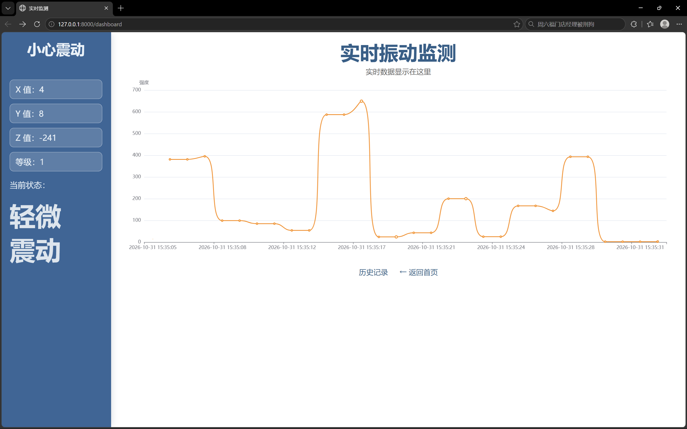
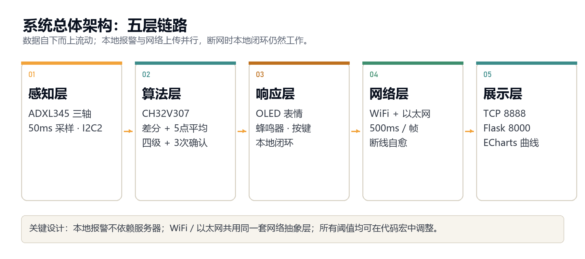
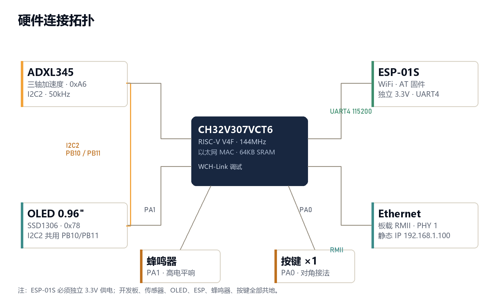

# 信号捕手 · CH32V307 智能震动报警器

> 2026 新生杯 · 嵌入式芯片应用创新赛道（沁恒 CH32V307）
>
> 项目代号：小心震荡

一套面向 **地震震动感知** 与 **无人值守防盗** 的低成本震动监测终端。  
CH32V307 完成三轴采集、分级判断、本地声光报警和双链路上传，电脑端用 Python 网页端展示实时曲线。



## 功能

- ADXL345 三轴加速度采集，50ms 周期
- 差分强度 + 5 点滑动平均 + 四级阈值 + 连续 3 次确认
- OLED 表情与状态显示，蜂鸣器本地报警，按键短按切模式 / 长按 1.5s 静音
- WiFi（ESP-01S）与以太网（板载 RMII）双链路，500ms 上传一帧
- 断线自动重连；断网时本地报警仍然工作
- 地震 + 防盗双场景：轻触记录、搬动/撬动触发报警、剧烈震动连续报警

## 系统架构



## 硬件连接



| 模块 | 引脚 | 说明 |
|---|---|---|
| ADXL345 | SCL/SDA → PB10/PB11 | I2C2，地址 0xA6 |
| OLED SSD1306 | SCL/SDA → PB10/PB11 | I2C2，地址 0x78 |
| 蜂鸣器 | I/O → PA1 | 高电平响 |
| 按键 | 对角脚 → PA0/GND | 短按切模式，长按静音 |
| ESP-01S | TX/RX/EN → PC10/PC11/3.3V | UART4，115200；独立 3.3V 供电 |
| 以太网 | 板载 RMII | PHY 地址 1，静态 IP 192.168.1.100 |

> ESP-01S 必须独立 3.3V 供电，所有模块共地。

## 仓库结构

```text
.
├─ firmware/                 CH32V307 MounRiver Studio 工程
│  ├─ User/main.c            主循环、算法、网络、OLED、按键
│  ├─ User/u8g2/             OLED 图形库
│  ├─ Core/ Peripheral/      芯片与外设驱动
│  ├─ NetLib/                WCHNet 以太网协议栈
│  └─ CH32V307_TCP.wvproj    MounRiver 工程文件
├─ server/
│  ├─ web_hello.py           FastAPI + ECharts 网页端（8000）
│  ├─ tcp_server.py          最小 TCP 调试服务器（8888）
│  └─ requirements.txt
└─ docs/                     架构图、硬件图、网页截图
```

## 编译与烧录

1. 安装 **MounRiver Studio**（MRS）。
2. 打开 `firmware/CH32V307_TCP.wvproj`。
3. 编译工程，用板载 WCH-Link 烧录。
4. 串口调试：USART1，115200。

> 仓库包含 `firmware/Debug/debug.c` 和 `debug.h`（延时/打印驱动源码），不包含 `obj/` 等编译产物，首次打开需要重新编译。

## 运行服务器

```bash
cd server
python -m venv .venv
.venv\Scripts\activate
pip install -r requirements.txt
python web_hello.py
```

本地电脑运行代码后浏览器打开：<http://127.0.0.1:8000>

- `web_hello.py`：FastAPI 网页端，8000 端口，内置 ECharts。
- `tcp_server.py`：最小 TCP 调试服务器，8888 端口，只打印收到的数据帧。

## 网络配置

在 `firmware/User/main.c` 中修改：

```c
#define WIFI_SSID     "ESP-01S"  //可以自定义修改WiFi名
#define WIFI_PASS     "00000000" //密码
#define SERVER_IP0    192
#define SERVER_IP1    168
#define SERVER_IP2    137
#define SERVER_IP3    1
#define SERVER_PORT   8888
```

- WiFi：ESP-01S 作为 Station 连接 2.4GHz 热点；电脑热点网关通常为 `192.168.137.1`。
- 以太网：目标地址为 `ETH_SERVER_IP`（默认 `192.168.1.10:8888`）。
- 以上为演示默认值，实际使用时改成本机热点/服务器地址。
- 以太网模式需把电脑 IPv4 设为 192.168.1.10，子网掩码 255.255.255.0；端口为 8888。

## 数据协议

板端每 500ms 发送一帧 ASCII 文本：

```text
ax,ay,az,diff,level\n
```

| 字段 | 含义 | 范围 |
|---|---|---|
| ax/ay/az | 三轴加速度原始值 | int16 有符号数 |
| diff | 滤波后的震动强度 | 0–1000+ |
| level | 当前等级 | 0 安全 / 1 轻微 / 2 防盗 / 3 地震 |

## commit

 -


## 团队

- 团队：信号捕手
- 队长：洪小璇
- 队员：韦郁林、许政阳

## 说明

本仓库用于 2026 新生杯参赛作品展示，包含可编译的嵌入式工程与服务器代码；设计文档、演示视频和实物照片在提交包中单独提供。
